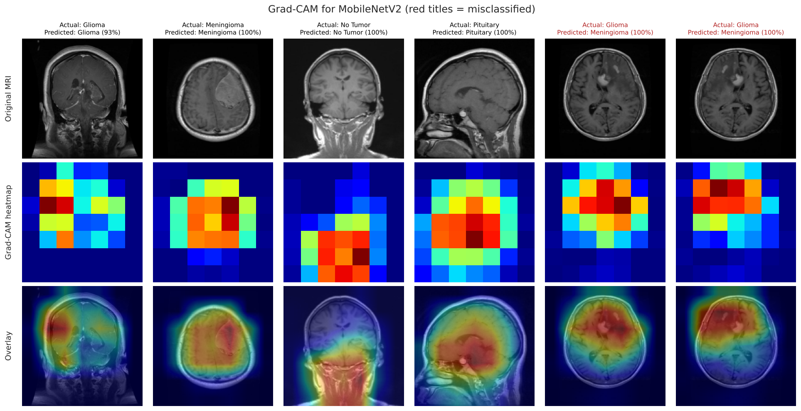
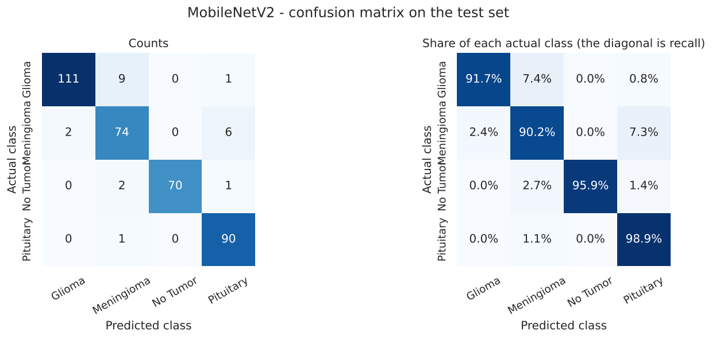
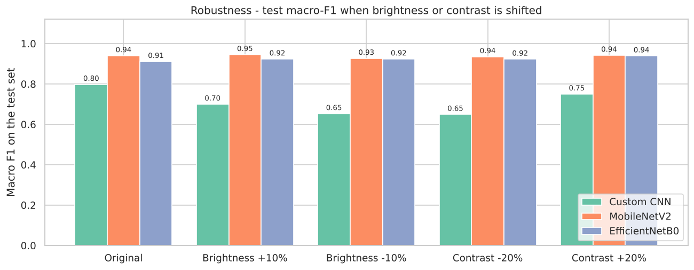

# Brain Tumor MRI Image Classification

Deep learning pipeline that classifies a 2-D brain MRI slice as **glioma**, **meningioma**, **pituitary tumor** or **no tumor**, compares a custom CNN with two pretrained networks, and serves the selected model in a Streamlit app.

**Live demo:** https://brain-tumor-mri-classification-sahil-md.streamlit.app/

> **Medical disclaimer.** This is an academic prototype for education and research. It is not a medical device, has not been clinically validated, and must not be used to diagnose, treat or rule out any condition.



## 1. Overview

| | |
|---|---|
| Task | Multi-class image classification (4 classes) |
| Data | 2,443 MRI slices, 640 x 640 px JPEG |
| Models | Custom CNN, MobileNetV2, EfficientNetB0 |
| Selected model | **MobileNetV2** (fine-tuned) |
| Test result | accuracy 0.940, macro F1 0.940 on 367 held-out images |
| Stack | TensorFlow / Keras 3, scikit-learn, Streamlit |

## 2. Problem statement

Develop a deep learning solution that classifies brain MRI images by tumor type: build a CNN from scratch, improve on it with transfer learning, compare the models, and deploy the best one in a web application that returns the predicted class with a confidence score.

## 3. Features

- Dataset loader that discovers classes automatically and audits every file (corruption, size, colour mode, duplicates)
- Detection of mirrored copies leaking across the supplied train / valid / test folders, and a leak-free re-split
- 15 EDA charts plus three statistical hypothesis tests
- One preprocessing function shared by training, evaluation and the app
- Custom CNN, MobileNetV2 and EfficientNetB0 with two-stage transfer learning
- EarlyStopping, ModelCheckpoint, ReduceLROnPlateau, CSVLogger
- Model selection that tests robustness to brightness and contrast shifts
- Confusion matrices, per-class metrics, ROC curves, error and confidence analysis, Grad-CAM
- Streamlit app with error handling, low-confidence warning and Grad-CAM overlay

## 4. Dataset

[Labeled MRI Brain Tumor Dataset](https://universe.roboflow.com/ali-rostami/labeled-mri-brain-tumor-dataset) (Roboflow Universe, CC BY 4.0). The dataset is **not** included in this repository.

| Class | Images |
|---|---|
| glioma | 805 |
| meningioma | 545 |
| no_tumor | 483 |
| pituitary | 610 |

**Data finding.** 352 pairs of images are left-right mirrored copies of each other, and 164 of those pairs are divided between the supplied train / valid / test folders (67 with one copy in the test folder). Evaluating on the supplied split would test the model on mirror images of training pictures. The notebook pools the images and creates a stratified split of **1,704 / 372 / 367** (train / validation / test) in which both copies always stay in the same subset.

**Bias finding.** Brightness, contrast and framing differ by class (for example, glioma images are the darkest), most likely because of how the images were collected. A model can exploit this instead of looking at the lesion.

## 5. Methodology

1. **Audit and EDA** - decode every file, compute image statistics, 15 charts (univariate, bivariate, multivariate), hypothesis tests.
2. **Preprocessing** - RGB, resize to 224 x 224, scale pixels to 0-1.
3. **Split** - 70 / 15 / 15, stratified by class and grouped by source picture, seed 42.
4. **Imbalance** - class weights in the loss (largest class is 1.67x the smallest).
5. **Augmentation (training only)** - rotation, zoom, translation, brightness, contrast, horizontal flip.
6. **Training** - Adam, sparse categorical cross-entropy, early stopping on validation loss.
7. **Selection** - on validation data only: worst-case macro-F1 across the original images and four brightness / contrast shifts; inference speed breaks ties.
8. **Final evaluation** - the test set is used once.

## 6. Model architectures

| Model | Description |
|---|---|
| Custom CNN | 4 blocks of Conv 3x3 - BatchNorm - ReLU (32, 64, 128, 256 filters), global average pooling, dropout, Dense 128, softmax. About 0.42 M parameters. |
| MobileNetV2 | ImageNet backbone + GAP + dropout + softmax. Stage 1: frozen backbone. Stage 2: top 30 layers fine-tuned at a 10x lower learning rate. |
| EfficientNetB0 | Same head and procedure; top 40 layers fine-tuned. |

Every model takes the same 0-1 RGB input; backbone-specific rescaling is a layer inside the model.

## 7. Results

Reference run: seed 42, CPU only (2 threads). Numbers will vary slightly between runs and machines.

| Model | Kept | Accuracy | Precision | Recall | Macro F1 | Weighted F1 | Macro F1, worst shift | Tumors predicted as no tumor | Params | Train (min) | ms / image | File (MB) |
|---|---|---|---|---|---|---|---|---|---|---|---|---|
| Custom CNN | tuned | 0.817 | 0.810 | 0.807 | 0.798 | 0.811 | 0.650 | 25 / 294 | 0.42 M | 8 | 17 | 1.8 |
| **MobileNetV2** | fine-tuned | 0.940 | 0.940 | 0.942 | 0.940 | 0.941 | 0.927 | 0 / 294 | 2.26 M | 13 | 146 | 9.6 |
| EfficientNetB0 | fine-tuned | 0.916 | 0.914 | 0.913 | 0.912 | 0.915 | 0.912 | 4 / 294 | 4.05 M | 18 | 260 | 17.0 |

Precision and recall are macro averages on the test set. "Worst shift" is the lowest test macro F1 after brightness +/-10 % or contrast +/-20 %.

**MobileNetV2, per class (test set)**

| Class | Precision | Recall | F1 | Images |
|---|---|---|---|---|
| Glioma | 0.982 | 0.917 | 0.949 | 121 |
| Meningioma | 0.861 | 0.902 | 0.881 | 82 |
| No Tumor | 1.000 | 0.959 | 0.979 | 73 |
| Pituitary | 0.918 | 0.989 | 0.952 | 91 |



## 8. Model comparison

- **MobileNetV2 was selected.** It tied with EfficientNetB0 on the validation selection score (0.918 vs 0.922) and is faster and smaller.
- **Fine-tuning helped both pretrained models**: validation macro F1 rose from 0.826 to 0.918 (MobileNetV2) and from 0.805 to 0.922 (EfficientNetB0).
- **The custom CNN shows why robustness is tested.** Trained without augmentation it reached the highest validation macro F1 on unmodified images (0.935), but fell to 0.112 when brightness was raised by 10 % - it had learned image brightness, not anatomy. The augmented version is more stable (0.645 worst case) but less accurate (0.822), and is the one kept.
- **Confidence.** A 70 % confidence threshold flags 13 of 367 test images and catches 6 of 22 errors, so most errors are made with high confidence. Confidence is not a reliable safety net.



## 9. Installation

```bash
git clone https://github.com/SahilMD06/brain-tumor-mri-classification.git
cd brain-tumor-mri-classification
python -m venv .venv
.venv\Scripts\activate        # Windows   (macOS / Linux: source .venv/bin/activate)
pip install -r requirements.txt
```

Requires Python 3.11-3.13 and TensorFlow 2.16 or newer (Keras 3). The saved model files were written with TensorFlow 2.21.0 and will not load in TensorFlow 2.15 or older.

## 10. Dataset setup

Download the dataset and place it so that the class folders are at `data/Tumour/<split>/<class>/`:

```
data/Tumour/train/glioma/...      data/Tumour/valid/...      data/Tumour/test/...
```

A flat layout (`data/Tumour/<class>/...`) also works. To use another location, set the environment variable `BRAIN_MRI_DATASET_DIR` to the dataset folder.

## 11. Notebook execution

```bash
jupyter notebook notebook/Brain_Tumor_MRI_Classification.ipynb
```

Run all cells. A full run trains five configurations and takes about 80 minutes on a 2-core CPU (much less with a GPU). For a quick end-to-end check of the code on a small subset, set `BRAIN_MRI_QUICK_RUN=1` before starting Jupyter; do not report results from a quick run. The first run downloads ImageNet weights and needs an internet connection.

The notebook writes the models to `models/`, the charts to `reports/figures/`, and the metrics to `reports/model_comparison.csv` and `reports/results.json`.

## 12. Streamlit execution

The app is deployed on Streamlit Community Cloud: https://brain-tumor-mri-classification-sahil-md.streamlit.app/ (it may take a minute to wake up if it has been idle).

To run it locally:

```bash
streamlit run app/app.py
```

The trained model is already in `models/`, so the app runs without retraining.

## 13. Example prediction

Choose a file from `assets/sample_images/` (unseen test images) in the app, or upload your own. The app shows the predicted class, the confidence, the probability of every class, a warning below 70 % confidence, and an optional Grad-CAM overlay. From Python:

```python
from src.inference import load_trained_model, load_class_names, predict_image
model = load_trained_model("models/final_model.h5")
classes = load_class_names("models/class_names.json")
print(predict_image(model, "assets/sample_images/meningioma_1.jpg", classes))
```

## 14. Project structure

```
├── notebook/Brain_Tumor_MRI_Classification.ipynb   executed notebook
├── app/app.py                                      Streamlit application
├── src/
│   ├── preprocessing.py                            image loading, resizing, scaling
│   ├── inference.py                                prediction and Grad-CAM
│   └── utils.py                                    paths, logging, seeds, JSON
├── models/
│   ├── custom_cnn.h5, mobilenetv2.h5, efficientnetb0.h5
│   ├── final_model.h5, final_model.keras           selected model
│   ├── class_names.json, preprocessing_config.json
├── reports/                                        figures, comparison table, results
├── assets/sample_images/                           8 unseen test images for the demo
├── VIDEO_PRESENTATION_GUIDE.md
├── requirements.txt
└── README.md
```

## 15. Limitations

- One public dataset, one split, one training run; no confidence intervals.
- No patient identifiers, so slices from one patient may be in different subsets and results may still be optimistic.
- Class-related differences in brightness and framing; the robustness test covers intensity shifts only.
- 2-D exported JPEG slices, not DICOM volumes; mixed viewing planes.
- Confidence scores are uncalibrated; most errors are confident.
- The model outputs one of its four classes for any image, including images that are not brain MRI.
- No external or clinical validation.

## 16. Future work

External multi-centre validation, patient-level splits, calibration and uncertainty estimation, out-of-distribution detection, DICOM support, Vision Transformers and ensembles, containerised deployment with monitoring, clinical and regulatory validation.

## 17. Technologies used

Python, TensorFlow / Keras, NumPy, pandas, scikit-learn, SciPy, Matplotlib, seaborn, Pillow, Streamlit, Jupyter.

## 18. Video presentation

See `VIDEO_PRESENTATION_GUIDE.md` for a 10-minute speaking plan and likely questions.
